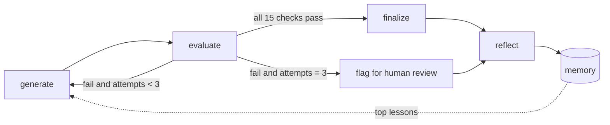

# Self-Evaluating Lesson Generator (RAG for beginners)

An agentic system that writes a beginner lesson, judges it against a pass/fail rubric,
and regenerates it with specific feedback until it passes, or escalates to a human.

**Topic:** Introduction to RAG (Retrieval-Augmented Generation)
**Learner:** 12th-grade graduate from India, limited English, no AI background.

## How it works



- **Generate:** writes the lesson from a prompt, a fact sheet, and lessons learned in past runs.
- **Evaluate:** 15 hard pass/fail checks. 5 are code (deterministic), 10 are judged by an LLM.
- **Regenerate:** failed checks (reason, quoted evidence, fix) go back to the generator. Max 2 retries.
- **Output:** the lesson in `outputs/`, and a rejection log in `logs/` (what failed, why, what changed).
- **Memory:** after each run, a reflect step turns failures into general rules (`memory/`), and
  the top 5 are injected into the next generator prompt.

## Rubric (config/rubric.yaml)

| Dimension | Checks | Type |
|---|---|---|
| Accurate and grounded | A1 no contradiction with fact sheet, A2 no invented facts, A3 states RAG does not retrain the model | LLM |
| Beginner language | L1 sentence length (avg and longest), L2 readability grade, L3 no idioms | Code, Code, LLM |
| No unexplained jargon | J1 key terms defined before use, J2 glossary has required terms | Code |
| Teaches by example | E1 everyday analogy, E2 worked example with and without retrieval | LLM |
| Covers key points | C1 what, C2 why, C3 how | LLM |
| Coherent flow | F1 section order, F2 no concept used before introduced | Code, LLM |

A lesson ships only if **all 15** pass. No partial credit.

## Setup (Windows PowerShell)

```powershell
python -m venv .venv
.venv\Scripts\Activate.ps1
pip install -r requirements.txt
copy .env.example .env      # then put your key in .env
```

`.env` uses any OpenAI-compatible provider (default: Google Gemini free tier):
```
PROVIDER_API_KEY=your_key_here
BASE_URL=https://generativelanguage.googleapis.com/v1beta/openai/
GEN_MODEL=gemini-flash-latest
JUDGE_MODEL=gemini-flash-lite-latest
```
To switch provider (Groq, OpenRouter, Ollama), change only these four lines.

## Run

| Command | What it does |
|---|---|
| `python main.py` | Full loop: generate, evaluate, regenerate, write outputs |
| `python main.py --sabotage` | Forces a weak first draft to demo the loop |
| `python main.py --evaluate-only <file.md>` | Judge an existing lesson |
| `python check_only.py [file.md]` | Run only the code checks (no API calls) |
| `python make_bad_lessons.py` | Build lessons with planted flaws in `tests/bad_lessons/` |
| `python run_code_tests.py` | Test code checks on planted flaws (no API calls) |
| `python run_tests.py` | Test the full evaluator, including the LLM judge |

## Evaluator tests

Control (the passing lesson) fails no code checks.

| Planted flaw | Expected catch | Result |
|---|---|---|
| Glossary removed | J2 | Caught |
| 41-word sentences | L1 | Caught |
| "Why" section removed | F1 | Caught |
| Example section removed | F1 | Caught |
| Wrong fact: "RAG retrains the model" | A1 and A3 (LLM) | Caught, with the contradiction quoted |
## Files

`main.py` entry point, `graph.py` LangGraph loop, `generator.py`, `evaluator.py`, `memory.py`,
`logger.py`, `llm.py` provider wrapper, `config/` (rubric, fact sheet, generator prompt),
`docs/` (design decisions, rubric changelog), `logs/`, `outputs/`, `memory/`, `tests/`.

## Known limitations

See `docs/design_decisions.md`.